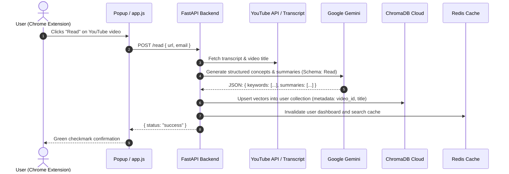
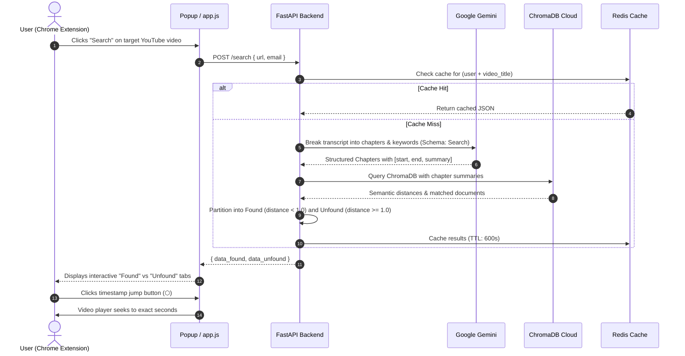

# 🐼 Lazy Panda

> **AI-Powered YouTube Learning Companion & Semantic Knowledge Base**  
> *Never re-watch what you already know. Discover new concepts, index video knowledge, and jump straight to what matters.*

---

## 📌 Table of Contents

- [Overview](#-overview)
- [Key Features](#-key-features)
- [How It Works (Architecture)](#-how-it-works-architecture)
- [Tech Stack](#-tech-stack)
- [Repository Structure](#-repository-structure)
- [Prerequisites](#-prerequisites)
- [Backend Setup & Installation](#-backend-setup--installation)
- [Frontend (Chrome Extension) Setup](#-frontend-chrome-extension-setup)
- [Environment Variables](#-environment-variables)
- [Database Schema (Supabase)](#-database-schema-supabase)
- [API Reference](#-api-reference)
- [User Walkthrough & Workflow](#-user-walkthrough--workflow)
- [Deployment](#-deployment)
- [Roadmap](#-roadmap)
- [License](#-license)

---

## 📖 Overview

When learning from long video lectures, tutorials, or conference talks on YouTube, learners often struggle with:
1. **Information Redundancy:** Re-watching concepts they have already mastered in previous videos.
2. **Missing Prerequisite / Novel Insights:** Identifying which specific segments of a 40-minute video contain completely new topics versus known reviews.
3. **Friction in Navigation:** Manually scrubbing through video timelines to find precise explanations.

**Lazy Panda** solves this with a **Chrome Extension (Manifest V3)** coupled with a **FastAPI + Google Gemini + ChromaDB RAG backend**:
- **"Read"**: Ingests transcripts of videos you've studied, analyzes them with **Google Gemini**, extracts key concepts & detailed summaries, and stores them in your personal **ChromaDB vector collection**.
- **"Search"**: When watching a new video, it performs semantic comparison between the current video's chapters and your cumulative knowledge base. It partitions concepts into **Found (Already Learned)** and **Unfound (Brand New)**.
- **One-Click Timestamp Seeking**: Allows direct jumping to timestamps in the active YouTube player from the extension popup.
- **Personal Knowledge Library**: A dedicated dashboard providing a library of all indexed videos, expandable summaries, keyword chips, and built-in embedded video playback.

---

## ✨ Key Features

- 🧠 **Automated Concept Extraction:** Powered by **Google Gemini 1.5 / 2.0 / 3.5 Flash** with strict structured JSON schema decoding.
- ⚡ **Semantic RAG Retrieval:** Uses **ChromaDB** vector similarity search to cross-reference new video content against your historical knowledge memory.
- 🎯 **Found vs. Unfound Distinction:**
  - **Found:** Concepts you have encountered in previous videos with exact distance metrics, descriptions, and timestamps.
  - **Unfound:** Topics introduced in the current video that do not exist in your memory collection.
- ⏩ **Direct YouTube Player Control:** Seamlessly commands the native YouTube HTML5 player (`video.currentTime`) to jump directly to any topic's timestamp without leaving the popup.
- 🚀 **High-Speed Redis Caching:** Caches extracted analysis and semantic search results to ensure instantaneous re-queries and low LLM latency.
- 📚 **Personal Video Library:** A dashboard (`library.html`) displaying video thumbnails, indexed topics, timestamped summaries, and an embedded modal player.
- 🔐 **Multi-Tenant & Secure:** Built with Supabase user authentication, SHA-256 hashed credentials, JWT session tokens, and Chrome local storage persistence.

---

## 🏗 How It Works (Architecture)

[](https://gitdiagram.com/satyam-1906/panda?utm_source=readme&utm_medium=badge)

### 1. Ingestion Pipeline ("Read")


### 2. Semantic Analysis Pipeline ("Search")


---

## 🛠 Tech Stack

| Domain | Technology | Description |
|---|---|---|
| **Extension Frontend** | Manifest V3, HTML5, CSS3, JavaScript | Lightweight popup UI, animated mesh glassmorphism, Chrome Scripting & Storage API |
| **Backend Framework** | [FastAPI](https://fastapi.tiangolo.com/) | High-performance Python async REST API |
| **Server / ASGI** | [Uvicorn](https://www.uvicorn.org/) | Lightning-fast ASGI web server |
| **LLM & Extraction** | [Google GenAI SDK](https://github.com/google/generative-ai-python) (`google-genai`) | Gemini models (`gemini-3.5-flash-lite` / `gemini-1.5-flash`) with structured schema generation |
| **Vector Database** | [ChromaDB](https://www.trychroma.com/) (Cloud / Local) | Vector embeddings and semantic nearest-neighbor retrieval |
| **Relational Database** | [Supabase](https://supabase.com/) (PostgreSQL) | User account management, authentication, and profiles |
| **Cache & Memory** | [Redis](https://redis.io/) | In-memory key-value store for transient query results and dashboard caches |
| **Transcript & Video** | `youtube-transcript-api`, `pytubefix`, NoEmbed | Transcript scraping and video metadata resolution |
| **Authentication** | PyJWT | JSON Web Token (JWT) stateless auth |
| **Tunneling / Hosting** | ngrok, Render (`Procfile`) | Public HTTPS endpoints for Chrome Extension testing and cloud deployments |

---

## 📂 Repository Structure

```text
panda/
├── .gitignore
├── frontend.crx                # Packaged Chrome extension bundle
├── frontend.pem                # Extension private key
├── backend/
│   ├── .env                    # Environment credentials (DO NOT COMMIT)
│   ├── database.py             # Supabase database client & auth operations
│   ├── extractor.py            # Google Gemini AI transcript analysis & structured schemas
│   ├── keepalive.py            # Background self-ping thread for free cloud host tiers
│   ├── main.py                 # FastAPI endpoints (/read, /search, /dashboard, /login, /register)
│   ├── Procfile                # Render / Heroku production start command
│   ├── rag.py                  # ChromaDB vector store integration & semantic retrieval
│   ├── requirements.txt        # Python backend dependencies
│   ├── run_server.sh           # Shell script to boot Uvicorn & ngrok simultaneously
│   ├── schema.py               # Pydantic models (Read, Search, Chapter, RegSchema, LoginSchema)
│   ├── test.py                 # Developer testing script for RAG data verification
│   ├── output/
│   │   └── search_output.csv   # Sample exported search/similarity data
│   └── rag_mem/                # Local ChromaDB persistence directory (fallback)
└── frontend/
    ├── manifest.json           # Chrome Extension Manifest V3 configuration
    ├── index.html              # Extension entry popup (Auth router & session check)
    ├── auth.js                 # Session token auto-login validator
    ├── popup.html              # Main extension popup (Read, Search, Found/Unfound lists)
    ├── app.js                  # Main popup logic, API calls, and YouTube DOM player seeking
    ├── log_n_reg.html          # Standalone full-page Login & Registration portal
    ├── log_n_reg.js            # Auth submission handling & Chrome storage persistence
    ├── library.html            # User's personal Video & Concept Knowledge Dashboard
    ├── library.js              # Dashboard cards renderer, search filter, and modal player
    └── assets/
        └── panda.png           # Lazy Panda icon assets (16x16, 32x32, 48x48, 128x128)
```

---

## ⚙️ Prerequisites

Before running the project, make sure you have:
1. **Python 3.10+** (tested with Python 3.11 / 3.12 / 3.14).
2. **Google Chrome** (or any Chromium browser: Brave, Edge, Opera).
3. **Google AI Studio API Key** (for Gemini access).
4. **Supabase Account** (with a project and table set up).
5. **Redis Server** (local instance or cloud service like Upstash / Redis Cloud).
6. **ChromaDB Cloud** credentials or local Chroma instance.
7. *(Optional)* **ngrok** (if testing local backend with the extension).

---

## 🚀 Backend Setup & Installation

### 1. Clone the Repository
```bash
git clone <repository_url>
cd panda/backend
```

### 2. Create and Activate a Virtual Environment
```bash
# Windows
python -m venv venv
.\venv\Scripts\activate

# macOS / Linux
python3 -m venv venv
source venv/bin/activate
```

### 3. Install Dependencies
```bash
pip install --upgrade pip
pip install -r requirements.txt
```

### 4. Configure Environment Variables
Create a `.env` file in the `backend/` directory:
```bash
cp .env.example .env   # Or create backend/.env manually
```
Fill in all required values (refer to [Environment Variables](#-environment-variables)).

### 5. Run the Server
#### Option A: Direct Uvicorn Run
```bash
uvicorn main:app --host 127.0.0.1 --port 8000 --reload
```

#### Option B: With ngrok Tunneling (for Extension testing)
If you are developing locally, start the backend and expose it via ngrok:
```bash
# Using the provided script
bash run_server.sh

# Or manually:
uvicorn main:app --host 127.0.0.1 --port 8001
ngrok http 8001
```

> **Note:** Update the `BACKEND` constant in `frontend/auth.js`, `frontend/app.js`, `frontend/library.js`, and `frontend/log_n_reg.js` with your active backend URL (e.g., `http://127.0.0.1:8000` or your `ngrok-free.dev` / Render URL).

---

## 🧩 Frontend (Chrome Extension) Setup

1. Open **Google Chrome** and navigate to `chrome://extensions/`.
2. Toggle on **Developer mode** in the top-right corner.
3. Click the **Load unpacked** button.
4. Select the `panda/frontend` directory.
5. The **Lazy Panda** extension icon (🐼) will now appear in your browser toolbar!
6. Pin the extension to your toolbar for easy access.

---

## 🔐 Environment Variables

Create a `backend/.env` file with the following variables:

| Variable | Description | Example / Default |
|---|---|---|
| `API_KEY` | Google Gemini API Key | `AIzaSy...` |
| `REDIS_HOST` | Host address of Redis instance | `localhost` or `your-redis.upstash.io` |
| `REDIS_PORT` | Port of Redis instance | `6379` |
| `REDIS_PASSWORD` | Password for Redis instance | `your_redis_password` |
| `SUPABASE_URL` | Supabase Project API URL | `https://xyzcompany.supabase.co` |
| `SUPABASE_KEY` | Supabase anon or service role API key | `eyJhbGciOi...` |
| `SALT` | Secret key used for signing JWT tokens | `super-secret-salt-key` |
| `ALGORITHM` | JWT signing algorithm | `HS256` |
| `CHROMA_KEY` | ChromaDB Cloud API key (if using CloudClient) | `ck-...` |
| `TENANT` | ChromaDB Tenant ID | `default_tenant` |
| `DATABASE` | ChromaDB Database Name | `default_database` |
| `PROXY_USERNAME` | *(Optional)* Proxy username for YouTube transcript fetch | `username` |
| `PROXY_PASSWORD` | *(Optional)* Proxy password for YouTube transcript fetch | `password` |

---

## 🗄 Database Schema (Supabase)

In your Supabase project, execute the following SQL statement in the SQL Editor to create the `panda_users` table:

```sql
create table public.panda_users (
    id bigint generated by default as identity primary key,
    created_at timestamp with time zone default timezone('utc'::text, now()) not null,
    full_name text default '',
    username text default '',
    email text unique not null,
    mobile_no text default '',
    password text not null
);

-- Enable Row Level Security (optional / recommended)
alter table public.panda_users enable row level security;
```

---

## 📡 API Reference

### Health Check
- **`GET /`** or **`HEAD /`**
  - **Response:** `{"status": "healthy"}`

### Ingestion ("Read Video")
- **`POST /read`**
  - **Headers:** `{"Schema": "Read"}`
  - **Body:**
    ```json
    {
      "url": "https://www.youtube.com/watch?v=dQw4w9WgXcQ",
      "email": "user@example.com"
    }
    ```
  - **Response:** `{"status": "success"}`

### Semantic Topic Search ("Search Video")
- **`POST /search`**
  - **Headers:** `{"Schema": "Search"}`
  - **Body:**
    ```json
    {
      "url": "https://www.youtube.com/watch?v=anotherVideoId",
      "email": "user@example.com"
    }
    ```
  - **Response:**
    ```json
    {
      "status": "successful",
      "data_found": {
        "keyword": ["Topic A"],
        "description": ["Description of topic A learned before..."],
        "distance": ["0.42"],
        "time_start": ["120.0"],
        "time_end": ["240.0"]
      },
      "data_unfound": {
        "keywords": ["New Concept B"],
        "descriptions": ["Detailed summary of novel concept B..."],
        "time_start": ["241.0"],
        "time_end": ["450.0"]
      }
    }
    ```

### User Dashboard / Library
- **`POST /dashboard`**
  - **Body:** `{"email": "user@example.com"}`
  - **Response:**
    ```json
    {
      "status": "successful",
      "data": {
        "dQw4w9WgXcQ": {
          "topic": ["Topic 1", "Topic 2"],
          "description": ["Summary 1", "Summary 2"]
        }
      }
    }
    ```

### Authentication Endpoints
- **`POST /register`**: Registers a new user, hashes password with SHA-256, returns a signed JWT token.
- **`POST /login`**: Authenticates user credentials, sets auth cookie, and returns JWT token.
- **`GET /auto-login`**: Accepts `Authorization: Bearer <token>` to validate existing sessions.

---

## 💡 User Walkthrough & Workflow

1. **Sign In / Sign Up:**
   - Click the Lazy Panda icon in Chrome.
   - If not signed in, click **Sign In** or **Register** to open `log_n_reg.html`.
   - Once logged in, your JWT token is saved securely in Chrome local storage.

2. **Index a Video You Have Watched:**
   - Open any informative YouTube video with English or Hindi transcripts.
   - Open the Lazy Panda extension popup.
   - Click **"Read"**.
   - The loader spins as Gemini extracts the key concepts and ChromaDB vectors are generated. A green checkmark confirms the video is indexed!

3. **Analyze a New Video:**
   - Navigate to another tutorial or video on the same or related subject.
   - Open the popup and click **"Search"**.
   - Review the two tabs:
     - **Found (Learned):** Concepts you've already learned from prior videos with semantic distance scores.
     - **Unfound (New):** Brand new concepts introduced in this video.
   - Click any item header to expand its summary.
   - Click the hex icon (`⬡`) to immediately jump the video to that exact timestamp!

4. **Explore the Library Dashboard:**
   - In the popup, click the **Library** button (or open `library.html`).
   - Browse your entire history of indexed videos, searchable by topic or title.
   - Play videos inside the integrated modal player and review topics covered.

---

## 🚢 Deployment

### Deploying the Backend on Render
The repository includes a `backend/Procfile`:
```text
web: uvicorn main:app --host 0.0.0.0 --port $PORT
```
1. Connect your repository to [Render](https://render.com/).
2. Select **Web Service** with the root directory set to `backend`.
3. Set the Environment to **Python 3**.
4. Set Build Command: `pip install -r requirements.txt`.
5. Set Start Command: `uvicorn main:app --host 0.0.0.0 --port $PORT`.
6. Add all required environment variables in the Render dashboard.
7. The included `keepalive.py` automatically keeps the instance active by pinging the root endpoint every 10 minutes.

---

## 🗺 Roadmap

- [ ] Support for non-captioned videos via Whisper / Gemini Audio transcription.
- [ ] Export personal knowledge summaries to Notion, Obsidian, and Markdown.
- [ ] Multi-language transcript support beyond English & Hindi.
- [ ] Video quiz generation from indexed concepts to test retention.
- [ ] Automated Chrome extension publish to the Chrome Web Store.

---

## 📄 License

This project is open-source under the [MIT License](LICENSE). Feel free to contribute, open issues, and submit pull requests!
